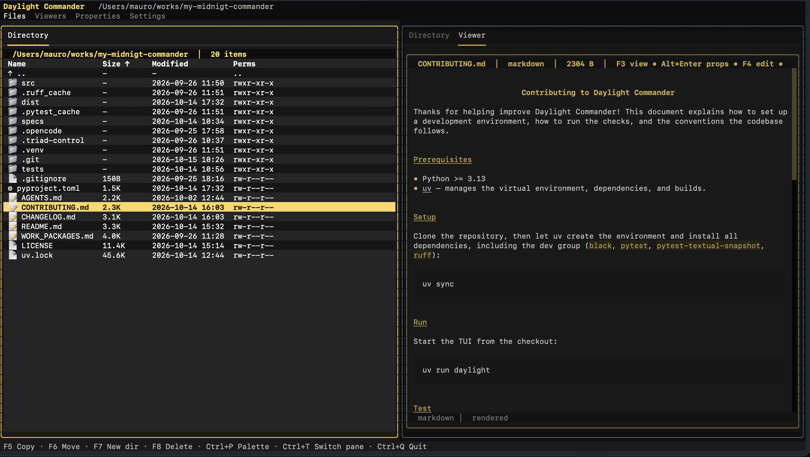
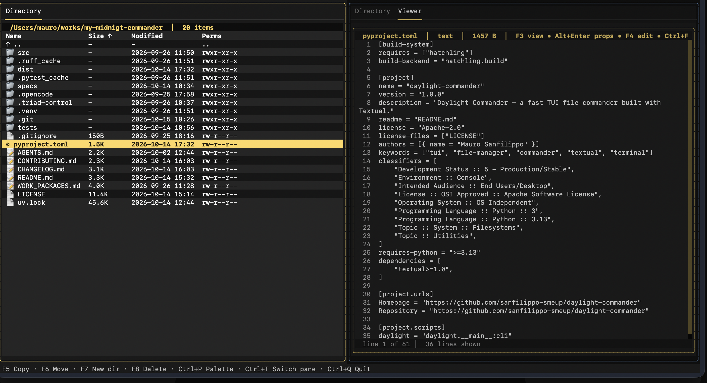
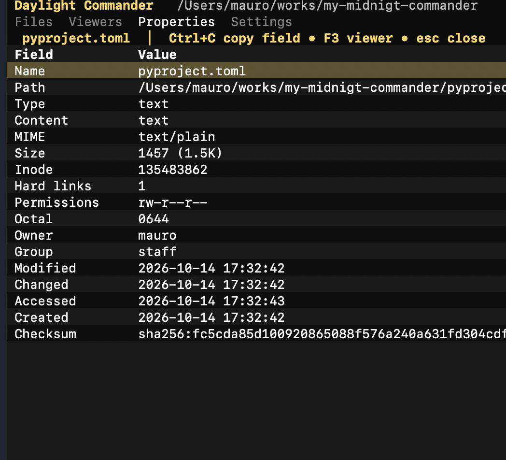
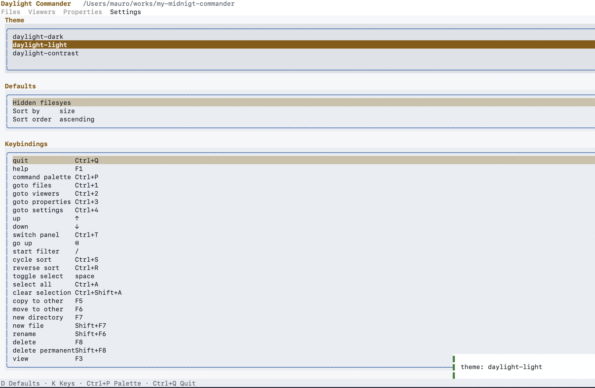
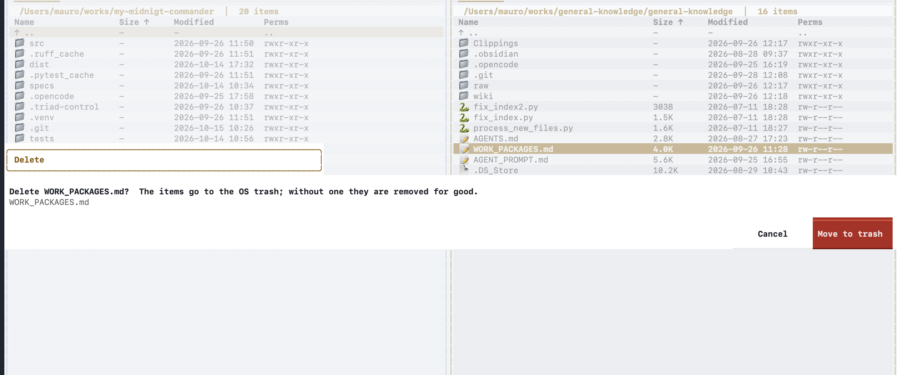
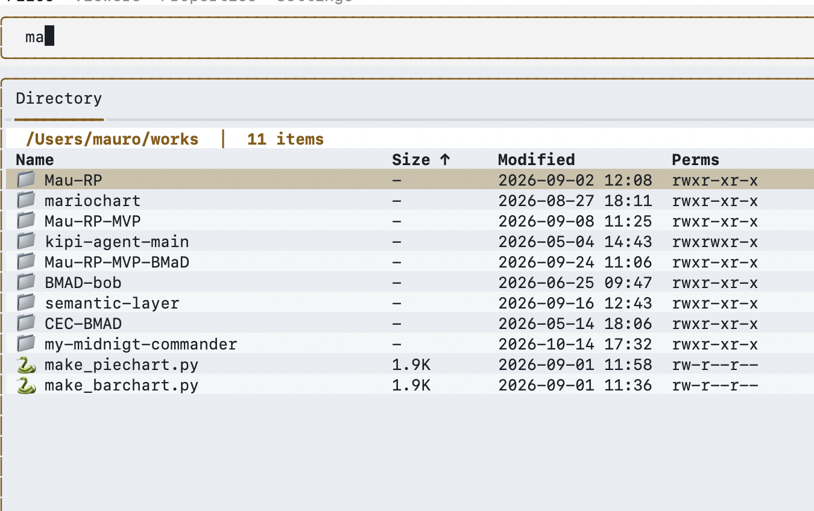
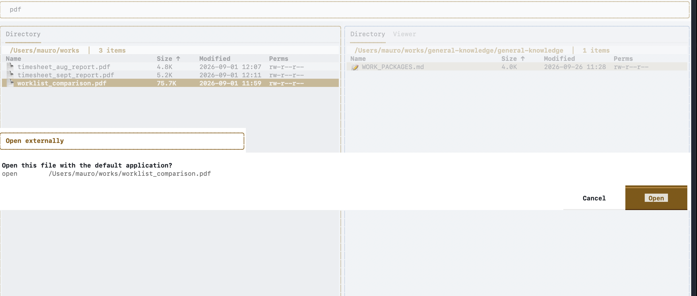
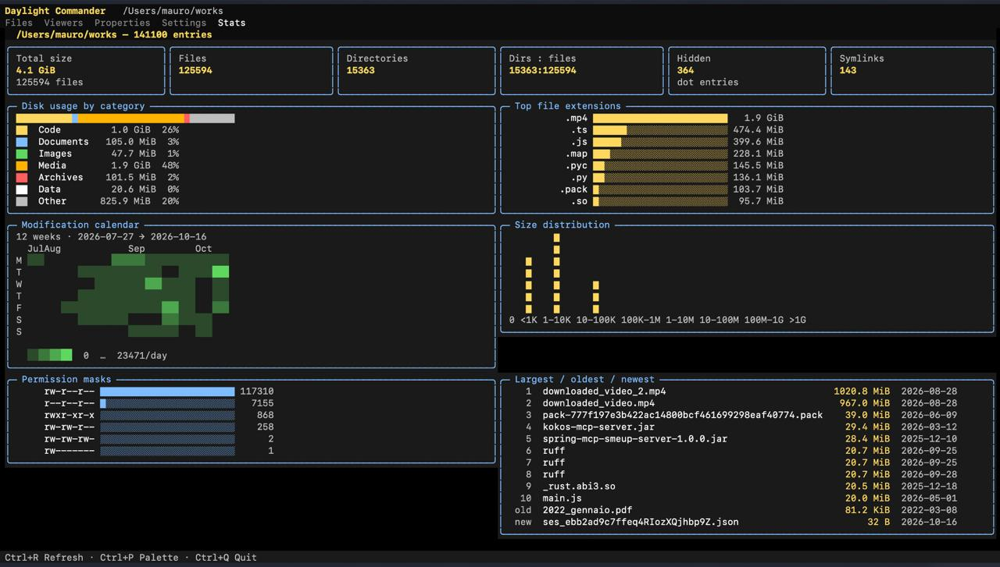

# Daylight Commander

**Daylight Commander** is a fast, dual-pane TUI file commander for the terminal,
built with [Textual](https://github.com/Textualize/textual). It brings the
classic Norton Commander workflow — two independent directory panes, F-key file
operations, and keyboard-first navigation — to a modern, themable Python
application.

## Screenshots

| | |
| --- | --- |
|  |  |
|  |  |
|  |  |
|  |  |

## Features

- **Dual-pane listing** — two independent directory panes with cursor
  navigation, type-ahead jumping, and hidden-file filtering (`/`).
- **File operations** — copy, move, rename, delete to trash, permanent wipe,
  new file, and new directory, all with confirmation dialogs.
- **Format-aware viewer** — inspect files in a viewer with pretty-printed
  JSON, line counts, and a find function; keep two viewer tabs open at once.
- **Sortable columns** — cycle sort keys and reverse the order on demand.
- **Command palette** — every action is reachable from the palette; the
  palette and the key footer are generated from the same binding table, so
  they can never disagree.
- **Runtime theming** — switch color themes live from the settings page.
- **Properties page** — detailed file metadata (size, permissions, owner,
  checksums) with per-field copy.
- **Stats dashboard** — a read-only `Ctrl+5` tab that summarizes the active
  pane's directory: total size and counts, disk usage by content category,
  top extensions, a modification calendar heatmap, a size histogram,
  permission masks, and the largest / oldest / newest files.
- **AI dashboard builder** — a `Ctrl+6` Builder tab where you describe a
  dashboard in natural language; an embedded `opencode` agent returns one
  declarative dashboard specification (a fenced JSON block, with clarifying
  questions when it needs to), and the dashboard opens in a dedicated Dashboard
  tab rendered natively with the app's own components and theme. Dashboards
  are saved and reloaded with `Ctrl+S` / `Ctrl+L` and refreshed with `Ctrl+R`.
  Requires the `opencode` CLI (v2, with v1 as a fallback); without it the tab
  shows a hint and the rest of the app is unaffected.
- **External launches** — open files with the system handler, edit in
  `$EDITOR`, and open URLs found in files with the default browser.

## Install

Daylight Commander requires **Python ≥ 3.13**. It is distributed via GitHub
(not PyPI); use [uv](https://docs.astral.sh/uv/) or `pip` to install it.

### Option 1 — install directly from GitHub (no checkout, no manual download)

With uv:

```bash
uv tool install "git+https://github.com/sanfilippo-smeup/daylight-commander.git"
```

Or with pip:

```bash
pip install "git+https://github.com/sanfilippo-smeup/daylight-commander.git"
```

Then run `daylight`.

### Option 2 — install from a release asset

Download `daylight_commander-1.2.0-py3-none-any.whl` from the
[latest release](https://github.com/sanfilippo-smeup/daylight-commander/releases/latest), then:

```bash
uv tool install ./daylight_commander-1.2.0-py3-none-any.whl
# or
pip install ./daylight_commander-1.2.0-py3-none-any.whl
```

### Option 3 — build from a source checkout

Clone the repository, then build or install locally:

```bash
git clone https://github.com/sanfilippo-smeup/daylight-commander.git
cd daylight-commander
uv build              # → dist/daylight_commander-1.2.0-py3-none-any.whl + .tar.gz
uv tool install .     # install the local package as a tool
```

### Option 4 — run without installing

```bash
git clone https://github.com/sanfilippo-smeup/daylight-commander.git
cd daylight-commander
uv run daylight
```

## Quick start

```bash
daylight              # if installed (options 1–3)
uv run daylight       # from a source checkout (option 4)
```

The TUI opens with two directory panes. Move the cursor with the arrow keys,
press `Ctrl+T` to switch panes, and use the F-keys below for file
operations. Press `Ctrl+P` for the command palette; every
page (Files `Ctrl+1`, Viewers `Ctrl+2`, Properties `Ctrl+3`, Settings `Ctrl+4`,
Stats `Ctrl+5`, Builder `Ctrl+6`, plus the dynamic Dashboard tab) is also
reachable from the palette and its tab.

## Keybindings

| Key | Action |
| --- | --- |
| `F3` | View file |
| `F4` | Edit file in `$EDITOR` |
| `F5` | Copy to other pane |
| `F6` | Move to other pane |
| `F7` | New directory |
| `F8` | Delete (to trash) |
| `Shift+F6` | Rename |
| `Shift+F7` | New file |
| `Shift+F8` | Wipe (delete permanently) |
| `F9` | Open link externally (URL under the cursor, with confirmation) |
| `Alt+Enter` | File properties |
| `Ctrl+S` | Cycle sort column |
| `Ctrl+R` | Reverse sort order |
| `Ctrl+C` | Copy field (properties page) |
| `Ctrl+G` | Next match (viewer find) |
| `Ctrl+P` | Command palette |
| `Ctrl+T` | Switch pane |
| `Ctrl+Q` | Quit |

Navigation extras: arrows move the cursor, `Backspace` highlights the `..`
parent row (press `Enter` to ascend),
`/` starts a filter, `Space` selects, `Ctrl+A` selects all, and `Escape`
closes the viewer.

## Configuration

Settings (theme, keybindings, defaults) are edited on the built-in settings
page (`Ctrl+4`) and persisted per user to `$XDG_CONFIG_HOME/daylight/config.json`
(`~/.config/daylight/config.json` by default). Custom keybindings override the
defaults shown above; the footer and command palette always reflect the active
bindings.

## AI dashboard builder (POC)

The Builder tab (`Ctrl+6`) generates a dashboard from a plain-language
description: you describe what you want to see, an embedded
[`opencode`](https://opencode.ai) agent answers with a single declarative
dashboard specification — one fenced JSON block — and the dashboard opens in a
native Dashboard tab. It is a proof-of-concept (PRD §5.8, ADR-016).

**Prerequisite.** The `opencode` CLI must be installed and on your `PATH` —
the app starts `opencode serve` on loopback automatically when you build.
Without it the Builder tab shows a hint and the rest of the app is unaffected.

**opencode versions.** The Builder supports opencode **v2**: it authenticates
with HTTP Basic auth using the per-process password the server prints at
startup, calls the JSON API under `/api`, streams the incremental
`session.text.delta` / `session.text.ended` events, and answers clarifying
questions delivered as forms (`form.created` → form reply). Older installs
that only speak the **v1** API are supported as a fallback: the version is
detected from the server's startup output, and the client switches protocol
automatically. The v2 API is experimental upstream and may drift; when it
does, the Builder degrades gracefully instead of crashing.

**Flow.**

1. Press `Ctrl+6`, type a prompt into the input (for example *"Summarize the
   CSV files in this directory as a dashboard"*), and press `Enter`.
2. The agent may ask a clarifying question; pick one of the offered options or
   type a free-text answer, and the build continues.
3. The agent replies with exactly one fenced JSON block — for example:

   ```json
   {
     "schema_version": 1,
     "title": "My directory",
     "blocks": [
       { "kind": "summary_cards", "source": "summary" },
       { "kind": "bar_chart", "source": "extension_counts", "top_n": 10 }
     ]
   }
   ```

   The Builder validates it and opens the Dashboard tab: one block per
   specification entry, rendered natively from the statistics of the directory
   you started the build in, with the app's own components and theme tokens.
   Summary cards, bar charts, share bars, histograms, heatmap and tables are
   real widgets — no ANSI output, HTML, SVG or generated code is ever rendered
   or executed. If the reply carries no valid specification, the Builder says
   exactly what was rejected and nothing is opened or run.

4. `Ctrl+S` saves the specification together with its directory and the prompt;
   `Ctrl+L` reopens a saved dashboard in the Dashboard tab; `Ctrl+R` refreshes
   the on-screen dashboard by recomputing its bound directory.

**Storage.** Saved dashboards are JSON files (name, prompt, specification,
directory, timestamps) under `$XDG_DATA_HOME/daylight/dashboards`, falling back
to `~/.local/share/daylight/dashboards`. Artifacts from Revision 5 carried a
generated Python *script* instead: they stay listed and marked "(legacy)" and
are never rendered or executed by the app.

**POC limitations.** The specification is a strict allowlist: the agent
describes the dashboard declaratively — summary cards, bar charts, share bars,
histograms, heatmaps and tables — and every number on screen comes from the
app's own statistics for that one directory. Anything outside the contract (an
unknown block kind or data source, another schema version, code) is rejected
with a precise error; no generated code is ever executed, and the dashboard is
bound to a single directory until you refresh (`Ctrl+R`) or load again
(`Ctrl+L`). The feature is single-user and local (no remote or multi-user
use), and the opencode v2 API is experimental upstream, so agent replies are
always validated, never trusted.

## How this project was made

Daylight Commander was built end-to-end by a human owner working with a
multi-agent team, not by a single coding assistant. The owner defined the goal,
the acceptance criteria, and every product decision; the agents did the
implementation, verification, and review under a disciplined loop.

**The team.** Work was coordinated through
[Triad+](https://github.com/ainz-dg/triad-plus-engineering-loop), a lightweight
engineering loop for coding agents that separates implementation, review, and
orchestration. Three roles, each with its own model, worked on every feature:

- **Coordinator** — the orchestrator. Broke the goal into bounded feature cards,
  created an immutable assignment packet per card, governed the state
  transitions, resolved developer/reviewer disagreements, and made the
  evidence-based delivery decisions. Model: `deepseek-v4.1-flash`.
- **Builder** — the developer. Implemented exactly one card at a time with the
  smallest change that satisfied its acceptance criteria, plus focused unit
  tests. Model: `glm-5.3-flash`.
- **Critic** — the reviewer. Independently inspected each verified candidate and
  approved, requested rework, or blocked it — never grading the same work it
  wrote. Model: `deepseek-v4.1-flash`.

The agents ran inside [OpenCode](https://opencode.ai), on Ollama-hosted models.

**The workflow.** Each feature moved through a repeatable chain:

1. The owner and Coordinator agreed a plan of bounded, testable feature cards
   (DC-001 … DC-032) derived from a frozen PRD baseline.
2. The Builder implemented one card, added tests, and reported precise claims.
3. A deterministic verifier (`triad-verify`) recorded the real gate results —
   `uv run ruff check .` and `uv run pytest -q` — as environment-derived
   evidence. A claim that the tests passed was never accepted as proof.
4. The Critic reviewed the candidate against its card, the diff, and the
   verifier evidence, and issued an independent decision.
5. On approval, the Coordinator committed exactly one commit per card and moved
   to the next dependency-satisfied card; on rework, the work looped back to the
   Builder.

Roughly 32 cards were delivered this way (plus a handful of targeted fixes),
with 802 passing tests and 16 UI snapshots guarded by the gates. When a card hit
a real fork in the road — a stale baseline, a flaky performance test, an
ambiguous acceptance criterion — work stopped and the owner decided; ordinary
implementation disagreements were resolved by the loop. See
[`docs/HANDOVER.md`](docs/HANDOVER.md) for the card-by-card delivery record.

**The post-run check — Evaluator+.** After the work was approved and delivered,
the project also used Triad+'s optional **Evaluator+**: a fresh, *blind*
assessment that runs in a clean context and sees only four things — the goal, the
acceptance target, the final artifact, and the environment-derived verification
evidence. It deliberately never sees the developer's or reviewer's reasoning, the
attempt history, or the internal run records, so its judgement cannot be anchored
to the story of how the work was done. It independently re-checked the delivered
product against the PRD's acceptance criteria and reproduced the test/lint gates
itself; the first pass caught an over-claim in the written requirements, which
was corrected, and the re-run returned **PASS**. An Evaluator+ verdict is only a
record: it can never reopen, rework, or rewrite an already-delivered result —
it is a last, independent sanity check on the outcome, not a fourth member of the
team.

**The stack.** Python ≥ 3.13 packaged with [uv](https://docs.astral.sh/uv/);
[Textual](https://github.com/Textualize/textual) for the TUI with styling kept
in `.tcss` files; `black` for formatting, `ruff` for linting, and
`pytest` + `pytest-textual-snapshot` for testing. Filesystem access is isolated
behind `managers/` so the UI never touches disk directly.

## Credits

- **Triad+** — the engineering loop that structured how this project was
  planned, implemented, verified, and reviewed — is created by
  [**ainz-dg**](https://github.com/ainz-dg) and available at
  [ainz-dg/triad-plus-engineering-loop](https://github.com/ainz-dg/triad-plus-engineering-loop)
  (Apache-2.0). Many thanks for building and sharing it.
- Built with [Textual](https://github.com/Textualize/textual),
  [uv](https://docs.astral.sh/uv/), [Ruff](https://docs.astral.sh/ruff/), and
  [pytest](https://docs.pytest.org/).

## License

Licensed under the [Apache License, Version 2.0](LICENSE).